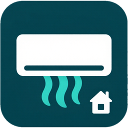

# Gree Local for Home Assistant

**Keep your Gree air conditioners off the internet.** Gree Local lets your units run with their
internet access fully blocked, so they can only be reached from your own network, through
Home Assistant.

## Why: security

- **Every Gree Wi-Fi module keeps a permanent connection to Gree's cloud.** In our tests the units
  connected to `eu.dis.gree.com` and `mqtt-eu.gree.com`, which run on Amazon AWS. Through that cloud
  your units can be switched remotely. A breached cloud, a leaked Gree+ account or a bug in the vendor's
  software reaches straight into your home.
- **This risk is not theoretical.** The GREE+ app itself had a published vulnerability
  ([CVE-2018-20582](https://cve-dev.imfht.com/detail/CVE-2018-20582), CSRF, CVSS 8.8). Other air
  conditioner brands have shipped hard-coded credentials in their Wi-Fi adapters
  ([CVE-2026-5667](https://nvd.nist.gov/vuln/detail/CVE-2026-5667), Mitsubishi Electric).
- **Simply blocking the internet does not work.** Newer Gree modules keep dropping off the Wi-Fi
  when they cannot reach the cloud, and then stop responding locally too.
- **Gree Local fixes this.** Home Assistant answers the cloud handshake itself, so the units stay
  online and fully controllable on your network, with no connection to the internet at all.

### What it protects, and what it does not

| | |
|---|---|
| ✅ | No connection from your air conditioners to Gree's servers |
| ✅ | No remote control through the vendor's cloud or a compromised Gree+ account |
| ✅ | No usage data leaves your home |
| ✅ | Gree Local only serves devices on your local network. Connections from public internet addresses are rejected. |
| ⚠️ | Gree's local protocol uses a publicly known key, so anyone already on your Wi-Fi can talk to the units. Put them on a separate IoT network or VLAN that only Home Assistant can reach. |
| ⚠️ | The Gree+ app and Gree firmware updates stop working. Use the Home Assistant app instead. |

## Setup

About 10 minutes, no programming needed.

**Before you start**

- The air conditioner is already on your Wi-Fi (set up once with the Gree+ app).
- It shows up in Home Assistant through the built-in **Gree Climate** integration
  (Settings → Devices & services → Add integration → Gree Climate).
- The **AdGuard Home** add-on is installed in Home Assistant, and your router gives out its address
  as the only DNS server. Any other DNS server that can rewrite `*.gree.com` works too.

**Steps**

1. **Install Gree Local.**
   Click the button, then *Download*, then restart Home Assistant (Settings → System → ⋮ → Restart).

   [](https://my.home-assistant.io/redirect/hacs_repository/?owner=csorbalazs306&repository=ha-gree-local&category=integration)

2. **Add the integration.**
   Settings → Devices & services → *Add integration* → **Gree Local** → *Submit*.
   The defaults are fine. Note the IP address it shows: that is your Home Assistant.

3. **Send Gree's servers to Home Assistant.**
   AdGuard Home → *Filters* → *Custom filtering rules* → add this line, with your Home Assistant IP
   from step 2, then *Apply*:

   ```
   ||gree.com^$dnsrewrite=192.168.1.10
   ```

4. **Block the air conditioner's internet access in your router.**
   Find the unit in your router's list of connected devices and block its internet access
   (usually under *Parental controls* or *Access control*).

5. **Restart the air conditioner.**
   Switch it off at the breaker or plug for 30 seconds, then back on.

Done. Within a minute the unit is available in Home Assistant again, now without internet.

**To undo:** delete the rule in AdGuard Home, remove the block in your router, and restart the
air conditioner.

## Options

Change them any time under Settings → Devices & services → Gree Local → *Configure*.

| Option | Default | Meaning |
|---|---|---|
| Home Assistant IP | detected | Address the units connect to |
| Server host name | `eu.dis.gree.com` | Host name announced to the units |
| TCP port | 5000 | Old firmware |
| TLS port | 1813 | Firmware 1.2x and newer |
| MQTT mode | `local_port` | See below |
| MQTT port | 1982 | MQTT port announced to the units |
| MQTT hold seconds | 0 | Keep at 0 |

**MQTT mode** only matters for newer modules that ask for MQTT (firmware 1.26 and newer). Their real
MQTT connection uses a certificate pinned in the firmware, so it cannot be faked. The mode decides
what Gree Local tells them instead:

- `local_port` (recommended): MQTT points at Home Assistant, which drops the connection. The unit
  stays responsive but retries constantly, about 1,500 short local connections per minute. None of
  them leave your network.
- `unresolvable_host`: MQTT points at a name that does not exist. The unit floods your DNS server
  with lookups instead.
- `none`: no MQTT info. Only for old firmware that does not ask for MQTT.

## Tested

| Wi-Fi module | Firmware | Result |
|---|---|---|
| `362001065279` (U-WB05RT13, GRJWB04-J) | V1.45 | Works with `local_port` and hold 0: answered 45/45 local probes and was fully controllable. With hold 10 s it stopped answering locally (0/45). |

## How it works

When a Gree unit starts, it asks the cloud which server to use. With `*.gree.com` pointed at
Home Assistant, Gree Local answers that question, and the login, time and heartbeat requests that
follow. Home Assistant then controls the unit directly over your network (UDP 7000) through the
built-in Gree Climate integration.

## Credits and license

Protocol handling is based on
[joserebelo/gree-dummy-tls-server](https://codeberg.org/joserebelo/gree-dummy-tls-server)
and [emtek-at/GreeAC-DummyServer](https://github.com/emtek-at/GreeAC-DummyServer).
Licensed under GPL-3.0, like the project it is derived from. Not affiliated with Gree Electric.
